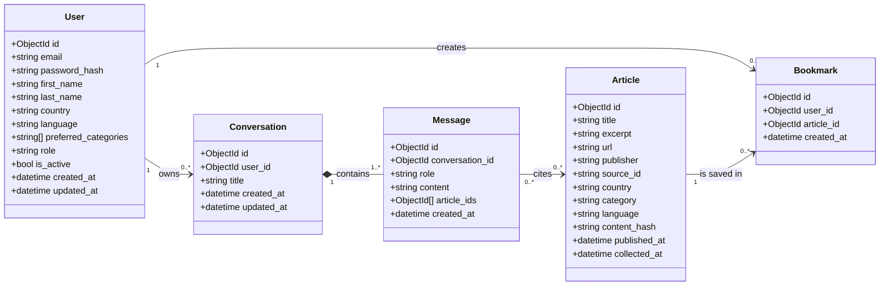

# Proposed Models Class Diagram

The Python model files are intentionally empty. This diagram defines the proposed domain model for their manual implementation.

## Suggested file ownership

- `user.py`: `User` and `Bookmark`
- `article.py`: `Article`
- `conversation.py`: `Conversation` and `Message`
