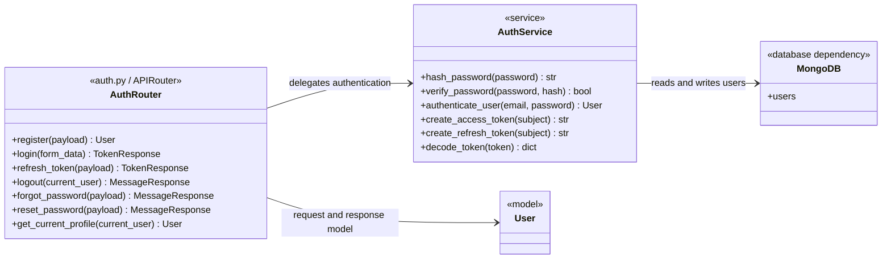

# Authentication Route Class Diagram



## Imports for `auth.py`

```python
from datetime import UTC, datetime, timedelta
from typing import Annotated

from fastapi import APIRouter, Depends, HTTPException, status
from fastapi.security import OAuth2PasswordBearer, OAuth2PasswordRequestForm
from jose import JWTError, jwt
from passlib.context import CryptContext
from pydantic import BaseModel, Field

from ..database import get_database
from ..models import User
```

If authentication logic is moved out of the route, create `services/auth_service.py` and also use:

```python
from ..services.auth_service import AuthService
```

