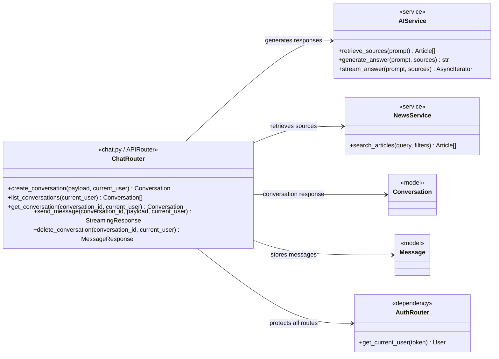

# Chat Route Class Diagram



## Imports for `chat.py`

```python
from collections.abc import AsyncIterator
from typing import Annotated

from fastapi import APIRouter, Depends, HTTPException, status
from fastapi.responses import StreamingResponse
from pydantic import BaseModel, Field

from ..database import get_database
from ..models import Conversation, Message, MessageRole, User
from ..services.ai_service import AIService
from ..services.news_service import NewsService
from .auth import get_current_user
```

