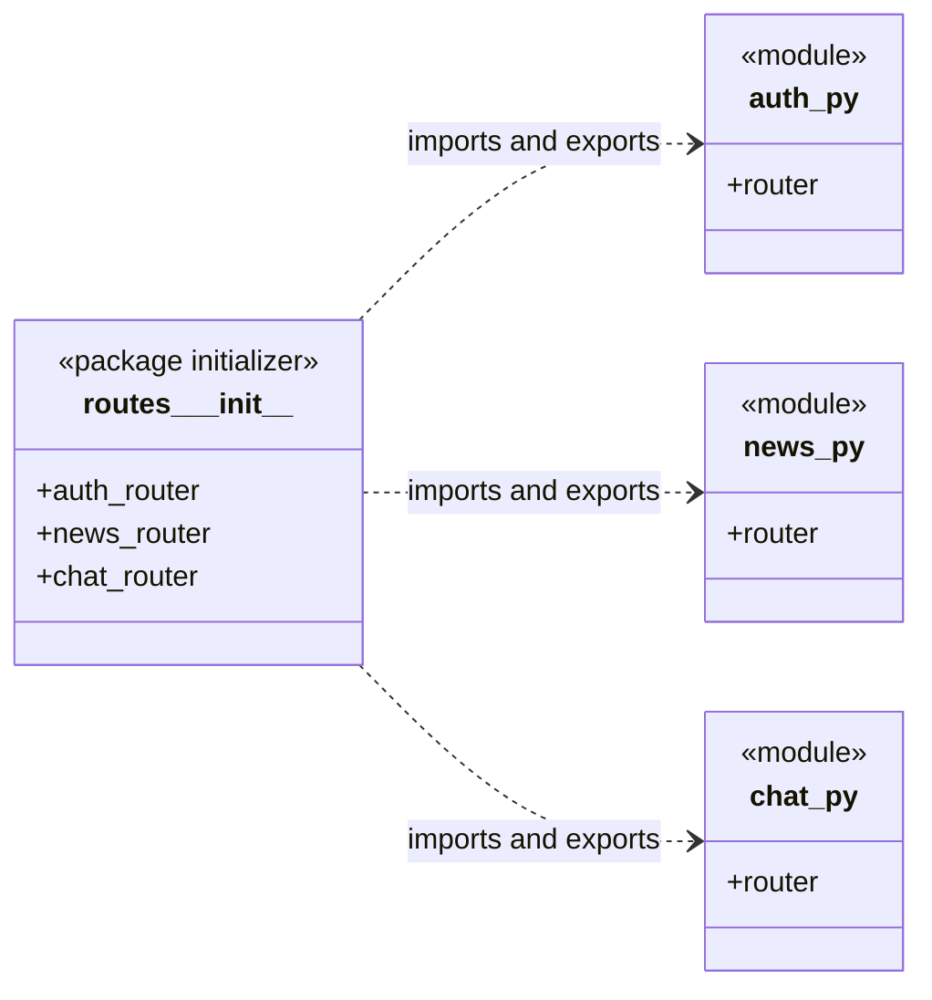

# Routes Package Initializer Diagram



## Imports for `routes/__init__.py`

```python
from .auth import router as auth_router
from .chat import router as chat_router
from .news import router as news_router

__all__ = ["auth_router", "chat_router", "news_router"]
```
