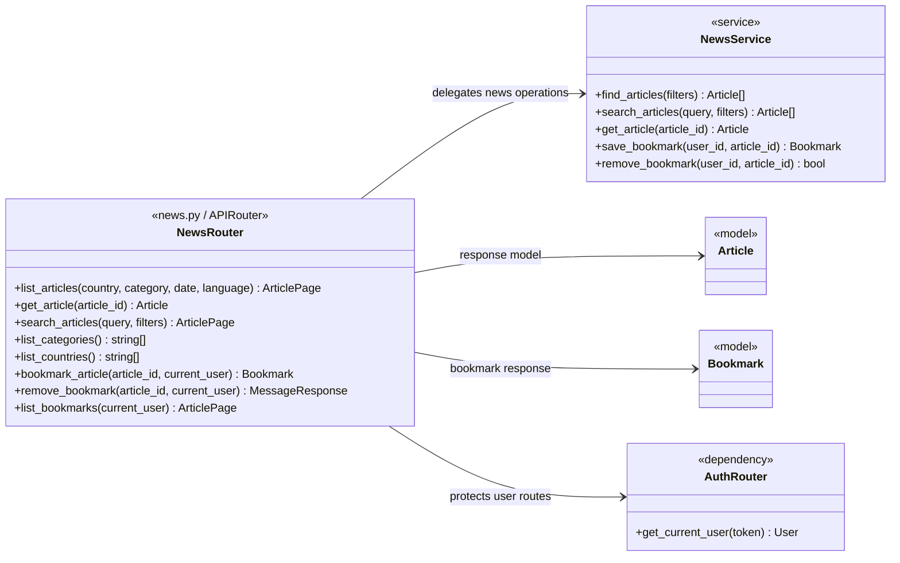

# News Route Class Diagram



## Imports for `news.py`

```python
from datetime import date
from typing import Annotated

from fastapi import APIRouter, Depends, HTTPException, Query, status

from ..database import get_database
from ..models import Article, Bookmark, User
from ..services.news_service import NewsService
from .auth import get_current_user
```

