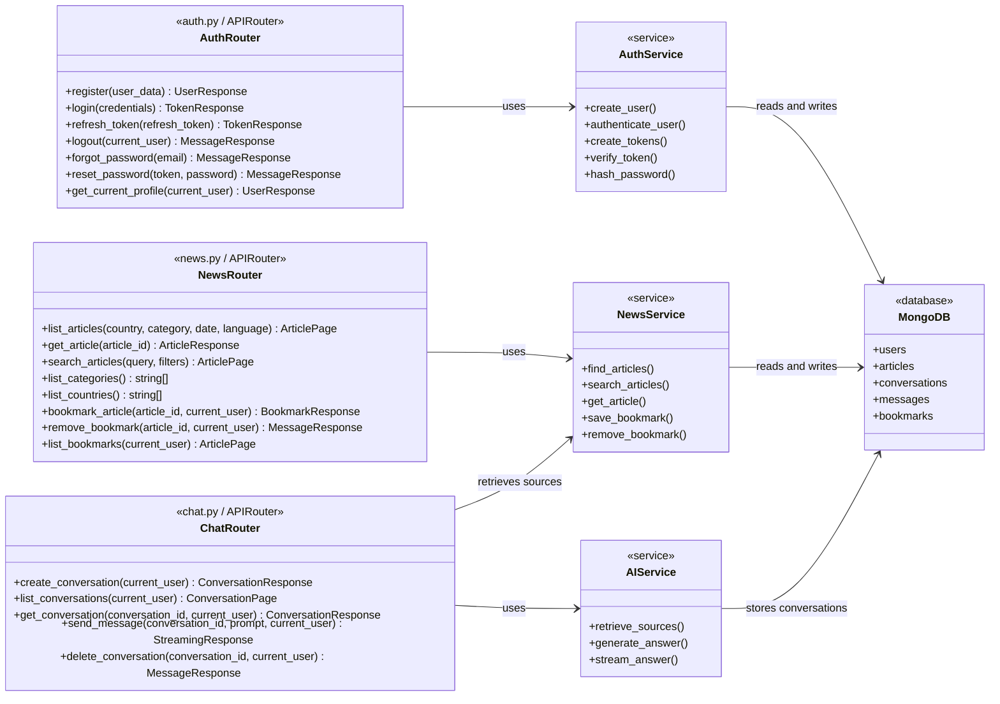

# Proposed Routes Class Diagram

The route modules are currently empty. This diagram defines the proposed FastAPI route structure and its dependencies.

## Suggested router prefixes

- `auth.py`: `/api/auth`
- `news.py`: `/api/news`
- `chat.py`: `/api/chat`
- `__init__.py`: exports `auth_router`, `news_router`, and `chat_router`
