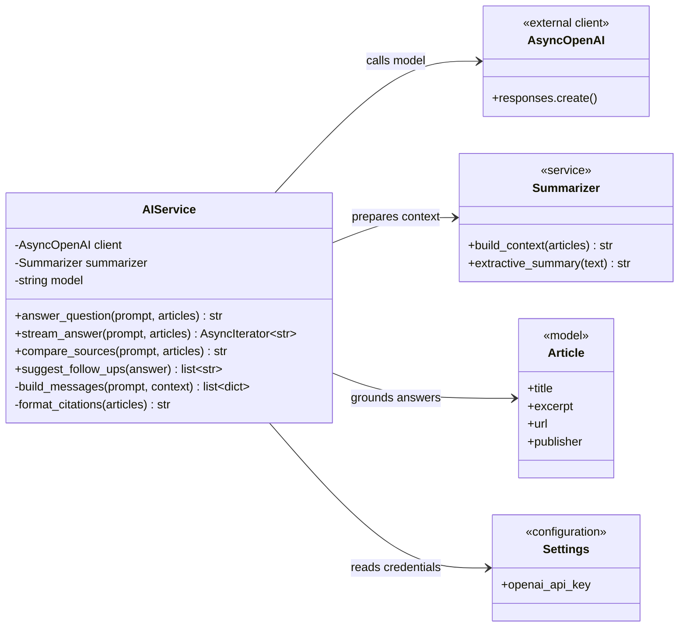

# AI Service Class Diagram

`ai_service.py` is currently empty. This diagram defines the proposed AI orchestration service.



## Imports for `ai_service.py`

```python
import logging
from collections.abc import AsyncIterator, Sequence

from openai import AsyncOpenAI

from ..config import settings
from ..models import Article
from .summarizer import Summarizer
```

These imports are already covered by the current `openai` dependency.

