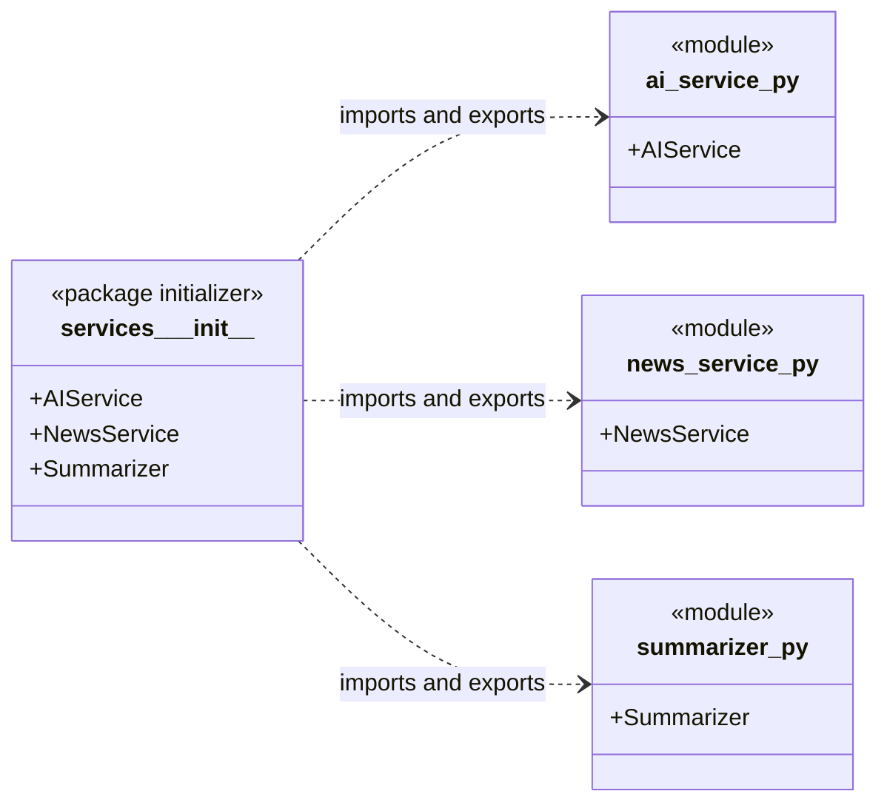

# Services Package Initializer Diagram



## Imports for `services/__init__.py`

```python
from .ai_service import AIService
from .news_service import NewsService
from .summarizer import Summarizer

__all__ = ["AIService", "NewsService", "Summarizer"]
```
