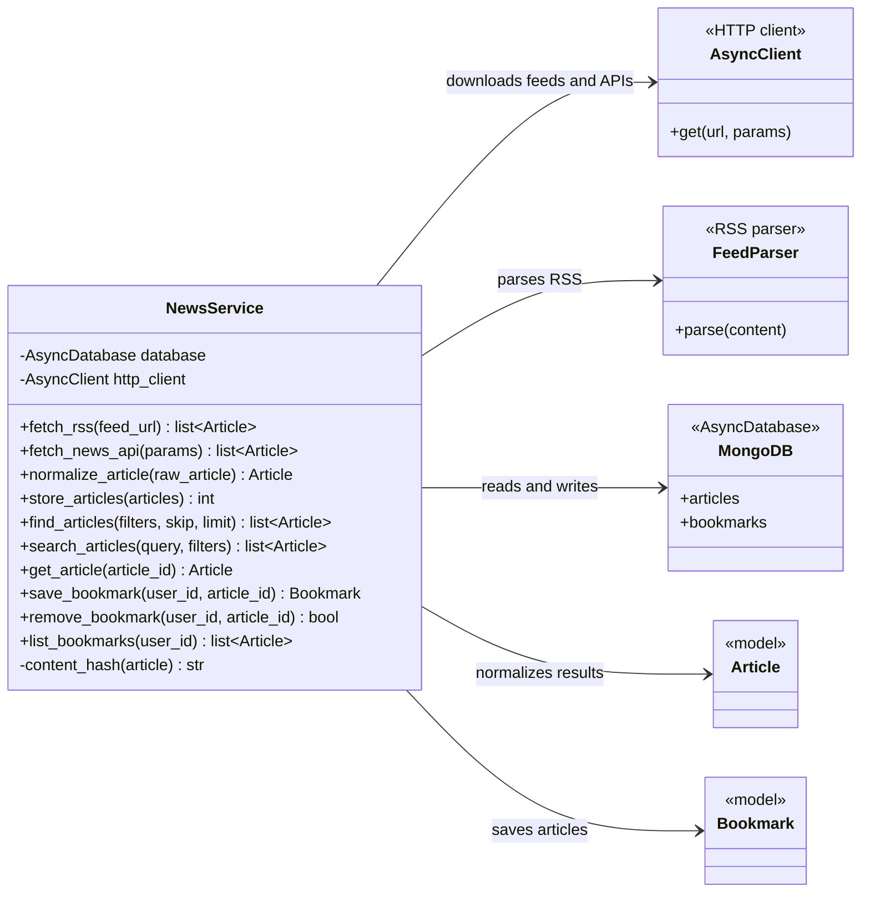

# News Service Class Diagram

`news_service.py` is currently empty. This diagram defines the proposed news collection, normalization and persistence service.



## Imports for `news_service.py`

```python
import logging
from datetime import UTC, datetime
from hashlib import sha256
from typing import Any

import feedparser
from bson import ObjectId
from httpx import AsyncClient, HTTPError
from pymongo.asynchronous.database import AsyncDatabase
from pymongo.errors import DuplicateKeyError

from ..models import Article, Bookmark
```

These imports are already covered by `feedparser`, `httpx`, and `pymongo` in `requirements.txt`.

