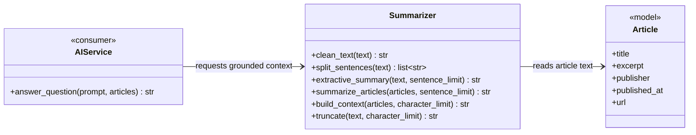

# Summarizer Class Diagram

`summarizer.py` is currently empty. This diagram defines a deterministic text-cleaning and extractive-summary service used before AI generation.



## Imports for `summarizer.py`

```python
import re
from collections.abc import Sequence
from html import unescape

from ..models import Article
```

All required imports are from Python's standard library except the existing `Article` model.

